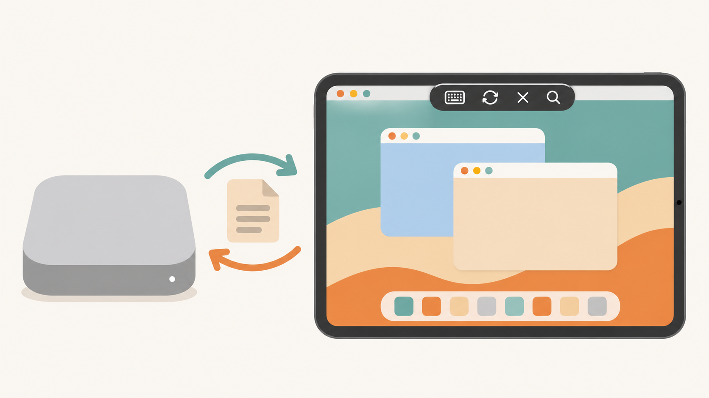
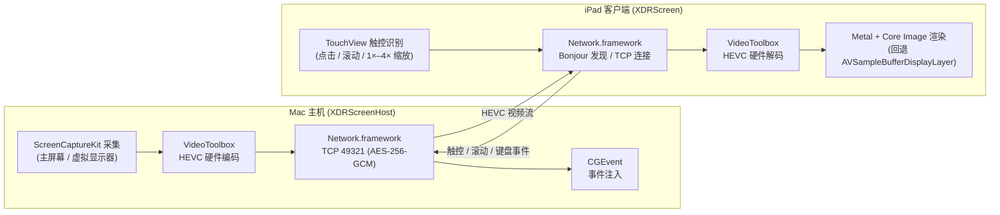

# XDRScreen

XDRScreen 是一个 macOS → iPad 的高性能局域网屏幕共享与触控回传工具，采用双端原生 Swift 编写。Mac 主机通过 ScreenCaptureKit 捕获桌面并经 VideoToolbox 进行 HEVC 硬件编码，通过 Bonjour 发现与 TCP 传输；iPad 客户端利用 VideoToolbox 硬件解码，并由 Metal 与 Core Image 渲染呈现。支持将 Mac 现有屏幕直接镜像，或为 iPad 动态创建 2× Retina 专用独立扩展屏，同时支持触控手势、视口缩放与键盘输入注入。



*示意图（AI 生成），用于说明整体形态；实际界面以运行效果为准。*

## 功能特性

- **双显示方式**：支持「镜像当前屏幕」与基于 macOS 私有 `CGVirtualDisplay` 的「iPad Retina 专用屏」（2732×2048 像素 / 1366×1024 点 @ 60 Hz SDR 独立扩展桌面）。
- **硬件编解码与渲染**：主机 VideoToolbox HEVC 硬件编码；iPad 端优先使用 Metal + Core Image 渲染（rgba16Float、extended-linear P3），Metal 不可用时回退至 `AVSampleBufferDisplayLayer`。具备首帧/格式代次门控与 15 秒静默看门狗自动重连机制。
- **触控与缩放手势**：支持单指点击与拖动、长按或双指轻点右键、双指拖动滚动；支持双指捏合 1×–4× 视口缩放，放大后双指拖动平移视口、三指拖动滚动，控制栏一键「适应」复位。
- **四档画质调节**：主机端支持「自动 / 清晰 / 均衡 / 省带宽」实时切换，两端也可直接指定目标码率；发送积压时自动降码率自适应。
- **双向文件传输**：Mac 与 iPad 之间可拖拽或选择文件互传，接收目录可自选；分块传输、SHA-256 校验、进度与取消。
- **常驻菜单栏**：Mac 端常驻菜单栏图标，关闭主窗口不影响后台串流与 iPad 连接。
- **端到端安全配对**：首次运行二维码或手动密钥配对，密钥保存在双端 Keychain；HMAC-SHA256 挑战握手、HKDF 派生会话密钥、AES-256-GCM 加密传输与单调序号防重放；纯局域网通信，无需云端。

## 架构与数据流



## 环境要求

| 组件 | 运行要求 | 构建要求 |
| --- | --- | --- |
| **Mac 主机** | macOS 15 或更高版本 | Xcode 16+（Swift 5.9+ 工具链） |
| **iPad 客户端** | iPadOS 16 或更高版本，全屏运行 | Xcode 16+，建议使用 TrollStore 等侧载工具安装 |
| **局域网** | 同一局域网且未开启 AP 隔离，开放 TCP 49321 端口，支持 Bonjour/mDNS | - |

## 构建步骤

项目使用 [XcodeGen](https://github.com/yonaskolb/XcodeGen) 维护工程描述，根目录下已包含预生成的 `XDRScreen.xcodeproj`。

如增删源文件，可重新生成工程文件：

```bash
xcodegen generate
```

### 1. 构建 Mac 主机 (`XDRScreenHost`)

主机应用未启用 App Sandbox，采用 ad-hoc 签名（`CODE_SIGN_IDENTITY = "-"`），本机运行无需开发者账号。

- **命令行构建**：
  ```bash
  xcodebuild -project XDRScreen.xcodeproj \
    -scheme XDRScreenHost \
    -configuration Debug \
    -derivedDataPath build \
    build

  open build/Build/Products/Debug/XDRScreenHost.app
  ```
- **Xcode 构建**：打开 `XDRScreen.xcodeproj`，选择 `XDRScreenHost` scheme 与 `My Mac` 目标，直接 Run。

### 2. 构建 iPad 客户端 (`XDRScreen`)

客户端需安装到 iPad 真机，支持通过 Xcode 调试安装或导出 IPA 侧载（如 TrollStore）：

- **命令行构建**（传入开发团队 ID 或配合自签名）：
  ```bash
  xcodebuild -project XDRScreen.xcodeproj \
    -scheme XDRScreen \
    -configuration Debug \
    -destination 'generic/platform=iOS' \
    -allowProvisioningUpdates \
    DEVELOPMENT_TEAM=<你的团队ID> \
    -derivedDataPath build-ios \
    build
  ```
- **打包 IPA（供 TrollStore 等侧载工具）**：
  ```bash
  mkdir -p Payload
  cp -R build-ios/Build/Products/Debug-iphoneos/XDRScreen.app Payload/
  zip -r XDRScreen.ipa Payload
  ```

### 3. 运行离线回归测试

在仓库根目录执行，验证协议、加密、虚拟屏调度与几何变换逻辑：

```bash
swift run WireRegression
```

当前测试套件共 629 项检查全部通过（包含协议回环、重放防护、文件传输协议、方向校正几何、视口缩放几何与 Metal 可用时的四角 GPU 测试；测试不等于真机验证）。

## 配对与日常使用

### 首次配对与权限授予

1. **Mac 权限**：首次启动需按提示授予 **屏幕录制**（读取屏幕）与 **辅助功能**（注入鼠标键盘事件）权限。更改权限后需重启主机应用。
2. **本地网络**：两端首次启动时均需在系统提示中允许访问「本地网络」。
3. **安全配对**：
   - Mac 窗口显示包含预共享密钥的配对二维码及链接；
   - iPad 客户端在列表中点选发现的主机，扫描二维码或手动粘贴密钥完成配对；
   - 密钥保存至双端系统 Keychain，后续启动支持自动重连。

### 菜单栏与后台运行

- 主机启动后常驻 macOS 菜单栏图标，可查看状态、重新打开主窗口或退出应用。
- 关闭主机主窗口**不会退出程序**，也不会断开 iPad 的当前连接与串流。

## 显示方式说明

主机提供两种显示模式，可在主机窗口中切换：

| 显示方式 | 实现机制 | 分辨率与特性 | 使用场景 |
| --- | --- | --- | --- |
| **镜像当前屏幕** | 捕获 Mac 当前主显示器画面 | 与主屏幕物理分辨率一致；不修改屏幕拓扑 | 快速查看或演示 Mac 当前主屏内容 |
| **iPad Retina 专用屏** | 基于私有 `CGVirtualDisplay` 动态创建独立虚拟屏 | 2732×2048 像素 / 1366×1024 点 @ 60 Hz（2× HiDPI，SDR，EDR 实测 1.0） | 独立扩展桌面；iPad 断开连接时保留桌面 |

> **注意**：专用屏是一块**独立扩展桌面**（非镜像），不会自动搬移现有窗口。连接后可将窗口拖入专用屏，或在主机窗口点击「设为主屏」（将 macOS 菜单栏移至专用屏）；退出主机或切换模式时会自动尝试恢复原显示器排列。若虚拟屏创建失败，会自动回退至镜像模式。

## 手势与键盘操作

手势在 iPad 画面的视频有效区域内生效（黑边区域忽略触控）：

| 操作手势 | 触发动作 |
| --- | --- |
| **单指轻点** | 鼠标左键单击 |
| **单指长按**（约 0.6 秒无位移） | 鼠标右键单击 |
| **双指快速轻点** | 鼠标右键单击 |
| **单指按住并拖动** | 鼠标左键拖拽（选区或移动窗口） |
| **双指拖动**（1× 视口） | 滚动页面（双向像素级滚动增量） |
| **双指捏合** | 画面 1×–4× 视口缩放 |
| **双指拖动**（放大状态） | 平移画面视口 |
| **三指拖动**（放大状态） | 滚动页面（放大时双指用于平移） |
| **控制栏「适应」按钮** | 重置视口缩放为 1× 并居中 |
| **键盘输入** | 点击控制条键盘按钮唤出屏幕键盘或连接外接键盘；支持输入文本、Return、Tab、Delete、方向键等（**注：不转发 Cmd/Ctrl/Opt 修饰组合键**） |

## 画质与码率档位

主机提供四档预设，切换即时生效；在发送端出现网络积压时，各档位均会自动降码率保流畅：

| 档位 | 目标码率 (2732×2048@60 SDR) | 适用场景 |
| --- | --- | --- |
| **清晰** | 约 67 Mbps (0.20 bpp) | 高速稳定 Wi-Fi，文字与细线边缘最清晰 |
| **自动（默认）** | 约 47 Mbps (0.14 bpp) | 均衡清晰度与带宽，适合绝大多数家庭局域网 |
| **均衡** | 约 30 Mbps (0.09 bpp) | 清晰度与吞吐折中，适合一般无线网络 |
| **省带宽** | 约 17 Mbps (0.05 bpp) | 弱网、无线热点或带宽受限环境 |

除档位外，两端都可以直接指定目标码率：

- **主机窗口**：「目标码率」可选「跟随画质档位」或 10 / 20 / 30 / 50 / 80 / 120 Mbps，切换立即作用到当前编码器。
- **iPad 控制栏**：点按「码率」按钮（速度表图标）选择「跟随主机」或同样的码率档位；选择会保存到本机，并在已连接时通过加密通道发送 `.clientSettings` 同步给 Mac，立即生效，无需重连。未连接时只保存，下次连接自动发送。
- 手动码率优先于画质档位的 bpp 预算；两端都修改时，最后写入的一端生效（客户端设置会覆盖主机端的手动值）。主机最多接受 4–200 Mbps，超出范围会被钳制。
- 即使指定了目标码率，发送端出现网络积压时仍会自动降码率兜底，避免画面越积越卡。

## 文件传输

两端都支持双向传输，走同一条加密通道，不需要额外端口或云端：

- **Mac → iPad**：把文件拖到主机窗口的虚线区域，或点「发送文件…」。文件保存到 iPad 上选择的接收目录（默认 App 的「文件/Received」，可在 Files 中查看）。
- **iPad → Mac**：从「文件」App 或其他 App 把文件拖入画面即可发送；也可以点控制栏「文件」按钮，在传输面板里点「发送文件…」。Mac 端保存到主机窗口里选择的目录（默认 `~/Downloads/XDRScreen`）。
- **接收目录**：Mac 端用目录选择面板；iPad 端用系统文件夹选择器，授权以 security-scoped bookmark 保存，重启后仍可写入；两端都可「恢复默认」。
- **传输面板**：显示文件名、方向、进度与状态，可取消；接收完成的文件可分享（iPad）或在 Finder 中显示（Mac）。iPad 上还可以把已接收的文件行拖到其他 App。
- 每个方向同一时刻只传一个文件，多文件会排队；单文件上限 4 GiB；同名文件自动追加编号；断线或 App 退出会取消传输并删除未完成的临时文件。

### 消息类型

新增类型编号接在原 1–8 之后，原有编号不变。除 `fileChunk` 外均为 `WireJSON` 编码。

| 类型 | 编号 | 方向 | 载荷 |
| --- | --- | --- | --- |
| `fileOffer` | 9 | 发送方 → 接收方 | `{ id: UInt32, name: String, size: UInt64 }` |
| `fileAccept` | 10 | 接收方 → 发送方 | `{ id: UInt32 }` |
| `fileReject` | 11 | 接收方 → 发送方 | `{ id: UInt32, reason: String }` |
| `fileChunk` | 12 | 发送方 → 接收方 | 二进制，见下 |
| `fileEnd` | 13 | 发送方 → 接收方 | `{ id: UInt32, sha256: String }`（小写十六进制） |
| `fileCancel` | 14 | 双向 | `{ id: UInt32, reason: String }` |

`reason` 固定为六个短码之一：`busy`、`tooLarge`、`invalidName`、`io`、`cancelled`、`unsupported`。

### 分块格式

```
UInt32 大端 id | UInt64 大端 offset | 原始文件字节（最多 64 KiB）
```

- 每个方向同一时刻只允许一个传输；接收方在忙时对新 offer 回 `busy`。
- 接收方必须校验 `id` 匹配、`offset` 恰好等于已写入字节数、单块不超过 64 KiB、累计不超过 offer 的 `size`；任一不符即中止并回 `fileCancel`。
- 发送方等待 `fileAccept` 超过 30 秒即取消；发送时最多 4 个分块在途（以 send completion 维持）。
- 接收方先写临时文件，按序累计 SHA-256，收到 `fileEnd` 后校验摘要，再把临时文件重命名为唯一最终名（同名追加 ` 2`、` 3`…）。

### 边界

- 单文件上限 4 GiB；文件名取 `lastPathComponent`、去除控制字符与 `/`、`\`，拒绝 `.` 与 `..`，空名回退 `file`，UTF-8 长度上限 200 字节。
- 主机默认保存到 `~/Downloads/XDRScreen`；可在主机窗口选择其他目录（持久化于 `XDRScreen.host.fileDestination`），目录不可用时回退默认并提示。
- 会话断开时取消所有传输并删除未完成的临时文件。

## 故障排查

- **找不到主机**：
  - 确认 Mac 与 iPad 连接至同一 Wi-Fi，且路由器未开启访客隔离或 AP 隔离；
  - 检查 Mac 防火墙是否放行 `49321` 端口；确认两端均已开启「本地网络」权限。
- **有画面但触控无效**：
  - 检查 Mac 系统设置中的 **辅助功能** 权限，确认已授权 `XDRScreenHost`；修改后重启主机应用。
- **黑屏或无法出画面**：
  - 检查 Mac 系统设置中的 **屏幕录制** 权限；未授权时 ScreenCaptureKit 无法捕获帧。
  - 检查主机窗口事件日志；若虚拟屏创建失败，应用会提示已回退镜像。
- **画面方向异常**：
  - Metal 渲染路径已针对真机做上下翻转校正；若回退至「兼容渲染」模式，暂未应用该校正（见已知限制）。
- **画面卡顿或延迟升高**：
  - 将画质切换至「均衡」或「省带宽」档位；排查 5GHz Wi-Fi 信道拥堵或网络重传。

## 安全与隐私

- **无外部依赖**：不依赖任何云端中继、外部服务器或第三方账号，纯局域网点对点通信。
- **凭据隔离**：32 字节预共享密钥在首次配对时生成，仅存放在两端系统的 Keychain 中，不随 Bonjour 广播泄露。
- **通道安全**：每次连接通过 HMAC-SHA256 进行双向认证挑战，HKDF 派生会话密钥，所有视频数据与输入事件均采用 AES-256-GCM 加密，并由单调递增序号防止重放攻击。

## 验证状态与已知限制

### 真机验证 vs 未验证

| 验证状态 | 项目说明 |
| --- | --- |
| **已在真机验证** | 设备配对与重连、HEVC 视频流串流、画面方向（上下翻转校正后）、单指触控坐标映射、2732×2048@60 规格串流。 |
| **已部署、未逐项验证** | 常驻菜单栏与画质/码率切换；双指捏合缩放、放大后的双指平移与三指滚动；双向文件传输、拖入/拖出与接收目录选择。 |
| **未实测 / 待验证** | 端到端 HDR/EDR 真实显示亮度表现、长时间高负荷运行下的发热与性能稳定性。 |

### 已知限制

1. **画面方向校正**：早期版本画面在真机上呈现上下颠倒；当前 Metal 渲染路径依据真机反馈应用了相对于首版的上下翻转（top-to-bottom）几何校正。由于采集/编码/解码管线中的倒置根因尚未完全查明，备用渲染路径（`AVSampleBufferDisplayLayer`）未应用该校正。
2. **虚拟屏私有接口**：专用屏依赖 macOS 私有 `CGVirtualDisplay` 运行时接口，未来 macOS 更新可能导致接口行为变化或失效；创建失败时将回退镜像模式。
3. **功能边界**：仅支持单台 iPad 连接；不包含音频采集与传输通道；不支持剪贴板同步；键盘输入不转发 Command / Control / Option 等修饰组合键。文件传输只支持常规文件（不支持文件夹），每个方向同时一个传输。
4. **分发方式**：本项目面向个人测试与侧载（如 TrollStore），非 App Store 上架应用；主机采用 ad-hoc 签名，重新构建可能导致 macOS 重新提示授权。
5. **许可证**：本项目以 [GNU General Public License v3.0](LICENSE) 发布。

## 许可证

本项目以 GNU General Public License v3.0 发布，完整文本见 [LICENSE](LICENSE)。
